# Prep Loop

> **Full-Stack Technical Interview Preparation Workspace & Spaced Repetition Engine**

[](https://prep-loop.vercel.app)
[](https://nodejs.org/)
[](https://expressjs.com/)
[](https://cloud.mongodb.com/)
[](https://jwt.io/)
[](LICENSE)

Prep Loop is an engineering-grade interview preparation and peer practice tracker designed for computer science students and software engineering candidates. Built as a full-stack application (Phase 2), it unifies **SuperMemo SM-2 Spaced Repetition** for algorithmic retention, **takeUforward (Striver's) Core CS Sheets** for fundamental subjects, **Conflict-Free Peer Mock Interview Scheduling**, and **Live LeetCode & GeeksforGeeks REST Analytics** into a responsive web application powered by **Express.js**, **MongoDB Atlas**, and **Vercel Serverless**.

---

## 🏗️ Phase 2 Full-Stack Architecture

Prep Loop has transitioned from a client-side prototype (Phase 1) to a full-stack, cloud-first architecture where **MongoDB Atlas is the sole source of truth**. Browser `localStorage` is strictly restricted to the JWT Bearer Token and theme preference.

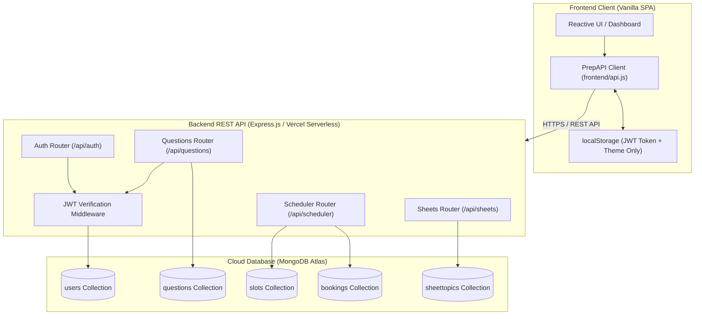

---

## 📸 Application Flow & Visual Walkthrough

Prep Loop provides a friction-free workflow from discovering features to onboarding, tracking algorithmic progress, mastering core computer science subjects, and practicing with engineering peers.

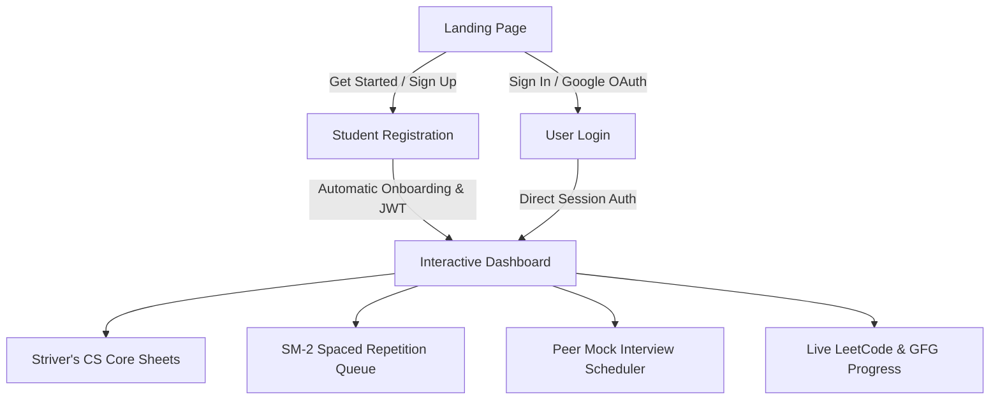

---

### Step 1: Landing Page & Value Proposition

When users first visit the platform, they are greeted by a modern, high-contrast landing page that introduces the core principles of Prep Loop: conquering the forgetting curve, mastering DSA, and practicing live peer mocks.

#### 1. Hero Showcase
The hero section features an interactive live workspace showcase displaying a mini 7-day review horizon chart, live platform indicators, and rapid access to registration.

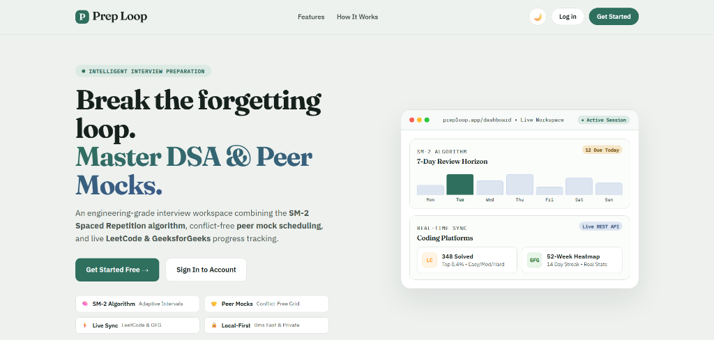

#### 2. Core Capabilities Breakdown
The landing page highlights the platform's four architectural pillars engineered for high-stakes technical interviews:

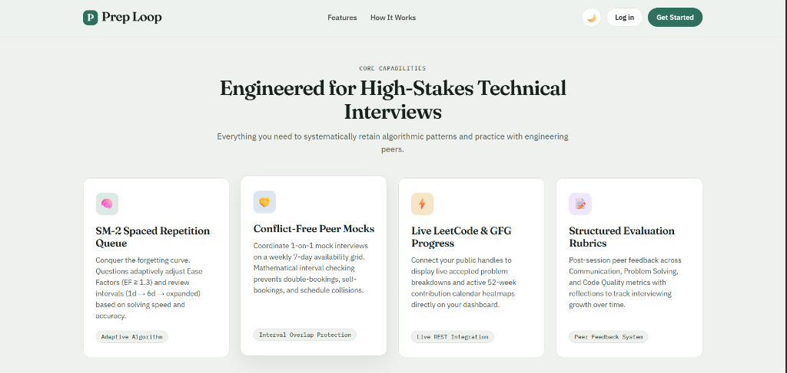

- **🧠 SM-2 Spaced Repetition Queue:** Adapts review intervals based on difficulty and solving outcome.
- **🤝 Conflict-Free Peer Mocks:** 7-day weekly schedule matrix with automated overlap prevention.
- **⚡ Live LeetCode & GFG Progress:** Dynamic stats and a 52-week activity heatmap.
- **📝 Structured Evaluation Rubrics:** Post-session peer reviews across Communication, Problem Solving, and Code Quality.

---

### Step 2: Seamless Authentication & Onboarding

Prep Loop features secure authentication powered by Express.js, bcryptjs, and JWT, with full Google OAuth 2.0 single sign-on.

#### 1. User Sign Up
New students register with their academic background and optional public coding handles.

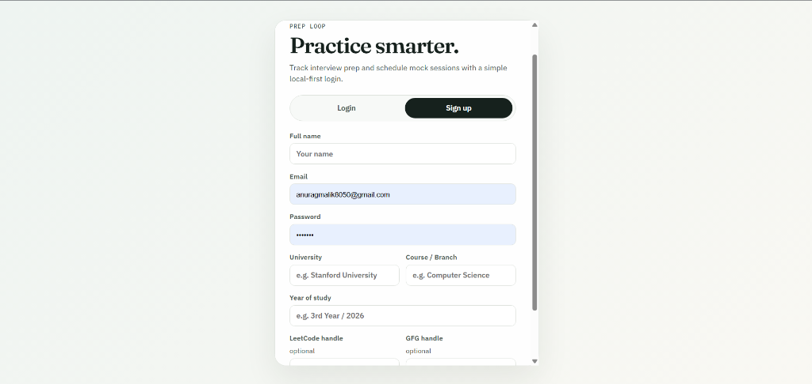

- **Mandatory Profile Details:** Full Name, Email, Password (hashed with bcrypt, 10 salt rounds), University, Course/Branch, and Year of Study.
- **Optional Coding Handles:** Connect LeetCode and GeeksforGeeks handles for instant dashboard synchronization.
- **Cloud Persistence:** Creates an authenticated profile document in MongoDB Atlas and immediately issues a 30-day JWT Bearer token.

#### 2. User Login & Google OAuth
Returning users authenticate with their email and password or 1-click Google Sign-In.

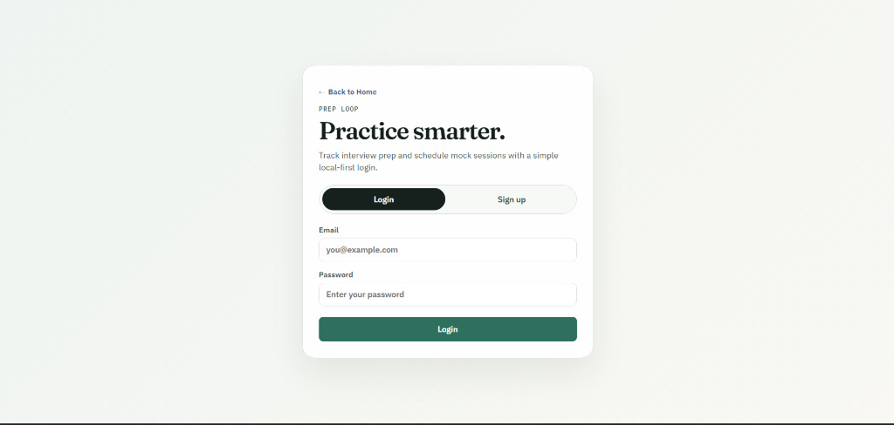

- **Direct Dashboard Routing:** Validates credentials against Atlas and transitions directly to the live dashboard.
- **Session Continuity:** Validates the stored JWT token with `/api/auth/me` on every page load to resume the session automatically.

---

### Step 3: Interactive Dashboard (Workspace Hub)

The Dashboard acts as the central command center for daily technical interview preparation:

#### 1. Profile Management & Core CS Readiness
Displays user credentials, preparation metrics summary, and an overview of Core CS readiness across Operating Systems, DBMS, and Computer Networks.

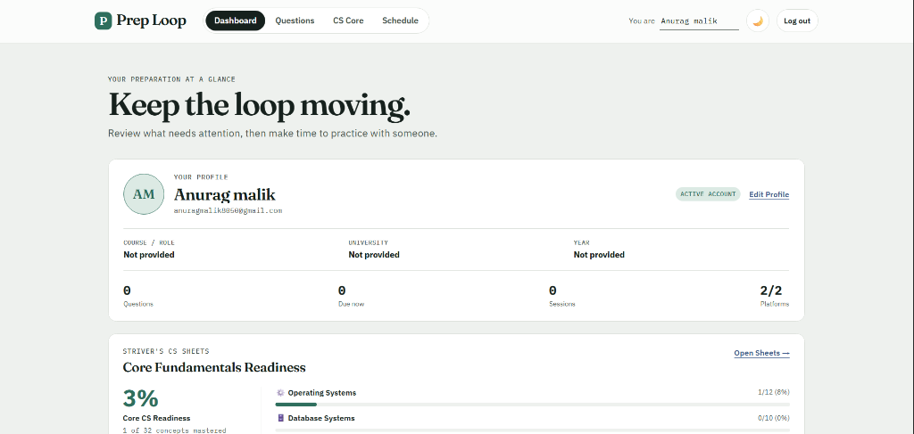

- **👤 Student Profile Card:** Displays name, email, university, degree, year, and counts for questions logged, due reviews, and sessions. Includes an editable profile modal.
- **🎯 Core CS Fundamentals Readiness:** Real-time completion bars across Operating Systems, DBMS, and Computer Networks, with smart alerts highlighting high-frequency interview questions.

#### 2. Live Platform Sync & Review Queues
Connects public coding profiles to stream live statistics, problem counts, and 52-week activity heatmaps alongside immediate review queues.

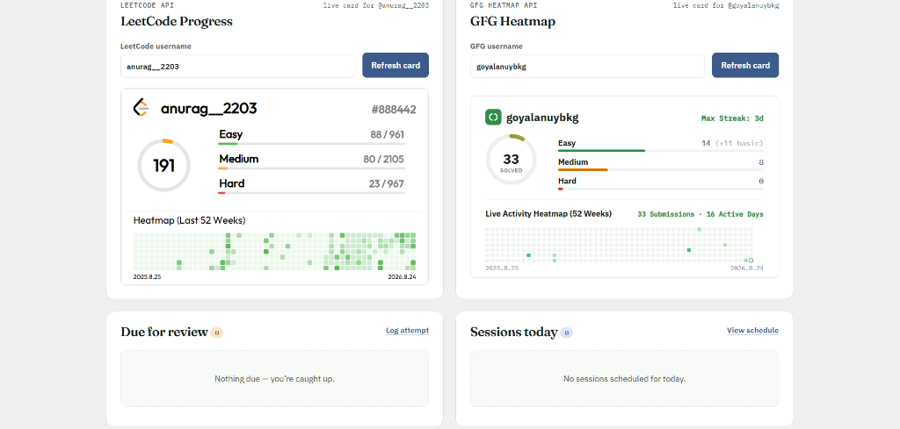

- **⚡ LeetCode Progress Card:** Fetches real-time accepted question counts across Easy, Medium, and Hard tiers along with submission heatmaps via `leetcard.jacoblin.cool`.
- **⚡ GeeksforGeeks Heatmap Card:** Renders total solved count ring, category metrics (Easy, Medium, Hard, Basic), active streaks, and a 52-week submission calendar via the GFG Stats API.
- **⏰ Due for Review Queue:** Shows questions needing immediate review based on the SM-2 algorithm.
- **📅 Today's Sessions:** Highlights confirmed peer mock interviews scheduled for the current day.

---

### Step 4: Striver's (takeUforward) CS Core Sheets

Dedicated interview sheets covering the most frequently asked computer science theory questions across core subjects, populated from the `sheettopics` collection in Atlas:

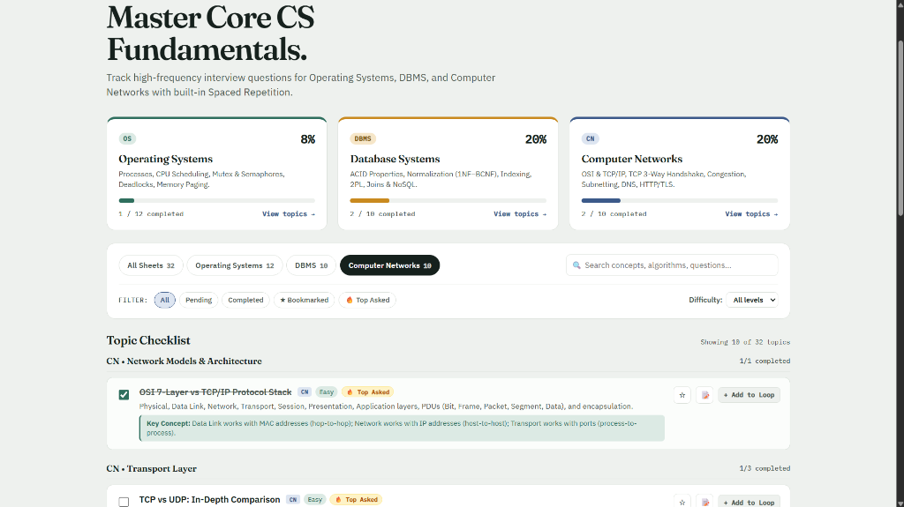

- **3 Core Subjects (32 Curated Topics):**
  - **Operating Systems (12 Topics):** Process States, CPU Scheduling, Mutex vs. Semaphores, Deadlock (Banker's Algorithm), Paging & Virtual Memory.
  - **Database Management Systems (10 Topics):** ACID Properties, Normalization (1NF to BCNF), B/B+ Tree Indexing, Transactions & 2PL, SQL vs. NoSQL.
  - **Computer Networks (10 Topics):** OSI & TCP/IP 7 Layers, TCP 3-Way Handshake, Congestion Control, Subnetting/CIDR, DNS & HTTPS/TLS Handshake.
- **Interactive Checklist:** Mark topics completed, filter by subject, difficulty, or `🔥 Top Asked` interview tags.
- **Revision Notes Drawer:** Expandable notes drawer per topic to store custom mnemonics, formulas, and interview traps.
- **1-Click Loop Integration (`+ Add to Loop`):** Instantly add any CS core topic to the SM-2 Spaced Repetition queue for periodic revision.

---

### Step 5: Spaced Repetition (SM-2) Question Tracker

An implementation of the SuperMemo SM-2 algorithmic workflow for DSA problem retention and pattern recall:

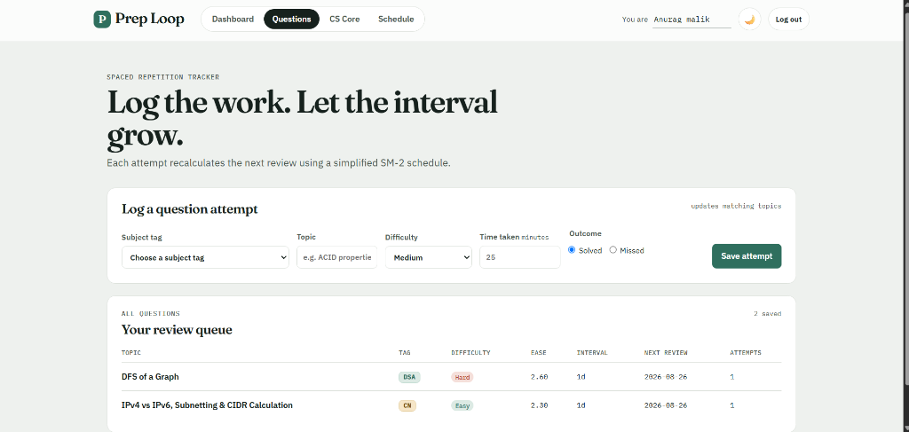

- **Log Question Attempts:** Record subject tag (`DSA`, `DBMS`, `CN`, `OS`), topic name, difficulty (`Easy`, `Medium`, `Hard`), solve duration, and outcome (`Solved` vs. `Missed`).
- **In-Place Recalculation:** Re-attempts trigger `PUT /api/questions/:id` in Atlas:
  - Updates Ease Factor ($EF \ge 1.3$).
  - Extends intervals ($1\text{d} \to 6\text{d} \to \text{interval} \times EF$).
  - Resets intervals on missed attempts to ensure timely concept recovery.
- **Review Queue Table:** Live tabular view displaying Topic, Subject Tag, Difficulty, Ease Factor, Current Interval, Next Review Date, Total Attempts, and an in-table **Delete** action (`✕`).

---

### Step 6: Peer Mock Interview Scheduler

A scheduling engine for 1-on-1 peer mock interviews synchronized via MongoDB Atlas:

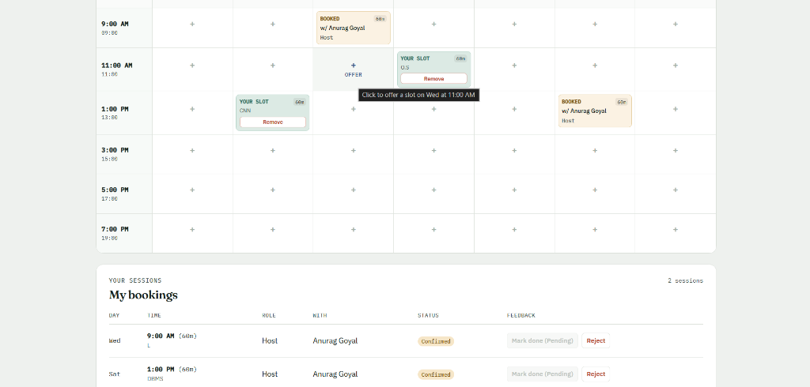

- **Weekly 7-Day Availability Grid:** Interactive matrix covering Monday through Sunday from 07:00 to 22:00.
- **Direct Cell Offering:** Click any open calendar cell (`+ Offer`) to pre-fill and offer a mock session in Atlas.
- **Custom Duration & Presets:** Choose from 30, 45, 60, or 90-minute session lengths or use 1-click time chips.
- **Mathematical Overlap Protection:** Prevents self-booking, double-booking, and overlapping session collisions.
- **Lifecycle Management:** Role-based controls to confirm, mark done (with session conclusion time validation), reject, or cancel sessions (which automatically frees the slot in Atlas).
- **My Bookings Dashboard:** Chronological list of hosted and requested sessions with direct action controls and post-interview rating rubrics (Communication, Problem Solving, Code Quality on a 1–5 scale).

---

## 🔌 REST API Specification

### Authentication Endpoints (`/api/auth`)
| Method | Endpoint | Description | Protected |
|---|---|---|:---:|
| `POST` | `/api/auth/register` | Register new student profile & issue JWT | No |
| `POST` | `/api/auth/login` | Authenticate with email & password | No |
| `POST` | `/api/auth/google` | Google OAuth token exchange & user sync | No |
| `GET` | `/api/auth/me` | Fetch active user profile from token claims | **Yes** |

### Questions Endpoints (`/api/questions`)
| Method | Endpoint | Description | Protected |
|---|---|---|:---:|
| `GET` | `/api/questions` | Get all questions logged by active user | **Yes** |
| `POST` | `/api/questions` | Log new question attempt with SM-2 parameters | **Yes** |
| `PUT` | `/api/questions/:id` | Update SM-2 interval/easeFactor on revision | **Yes** |
| `DELETE` | `/api/questions/:id` | Delete question from revision queue | **Yes** |

### Mock Scheduler Endpoints (`/api/scheduler`)
| Method | Endpoint | Description | Protected |
|---|---|---|:---:|
| `GET` | `/api/scheduler/slots` | Fetch all open & booked interview slots | No |
| `POST` | `/api/scheduler/slots` | Create a new offered interview slot | No |
| `DELETE` | `/api/scheduler/slots/:id` | Remove an offered slot from Atlas | No |
| `GET` | `/api/scheduler/bookings` | Fetch all bookings with populated slots | No |
| `POST` | `/api/scheduler/bookings` | Book an open interview slot | No |
| `DELETE` | `/api/scheduler/bookings/:id` | Cancel/reject booking & release slot | No |
| `POST` | `/api/scheduler/bookings/:id/feedback` | Submit reflection rating & comments | No |

### Striver CS Sheets Endpoints (`/api/sheets`)
| Method | Endpoint | Description | Protected |
|---|---|---|:---:|
| `GET` | `/api/sheets` or `/api/sheets/core` | Get all 32 curated Core CS topics | No |
| `GET` | `/api/sheets/core/:topicId` | Fetch a specific CS sheet topic by ID | No |

---

## 🚀 Running Locally

### Prerequisites
- [Node.js](https://nodejs.org/) (v18.0.0 or later recommended)
- A [MongoDB Atlas](https://cloud.mongodb.com/) cluster connection string (or local MongoDB)

### 1. Clone & Install Dependencies
```bash
git clone https://github.com/AnuragGoyal007/prep-loop.git
cd prep-loop
npm install
```

### 2. Configure Environment Variables
Create a `.env` file in the project root:
```env
PORT=5000
MONGO_URI=mongodb+srv://<username>:<password>@cluster0.bmlcmfy.mongodb.net/preploop?retryWrites=true&w=majority
JWT_SECRET=your_super_secret_jwt_key_here
```

### 3. Seed Database Topics
Seed the 32 Striver Core CS sheet topics into your Atlas cluster:
```bash
npm run seed
```

### 4. Run Development Server
```bash
npm run dev
```
Navigate to `http://localhost:5000` in your browser. Both the backend API and frontend static files will be served together.

---

## 🧪 Automated System Audit & Test Suite

Prep Loop includes an end-to-end audit suite that tests user registration, Google OAuth, question logging, SM-2 interval updates, slot booking, feedback submission, and database resetting:

```bash
npm run test:audit
```

To wipe test data and restore a clean slate with seeded topics anytime:
```bash
npm run reset-db
```

---

## 📁 Monorepo Project Structure

```text
prep-loop/
├── api/
│   └── index.js              # Vercel Serverless Function entrypoint
├── assets/
│   └── screenshots/          # High-resolution README walkthrough images
│       ├── auth-login.png
│       ├── auth-signup.png
│       ├── cs-core-sheets.png
│       ├── dashboard-platforms.png
│       ├── dashboard-profile.png
│       ├── landing-features.png
│       ├── landing-hero.png
│       ├── questions-sm2.png
│       └── schedule-grid.png
├── backend/
│   ├── config/
│   │   └── db.js             # Mongoose connection with DNS bypass & serverless caching
│   ├── controllers/
│   │   ├── authController.js       # Register, Login, Google OAuth, getMe
│   │   ├── questionController.js   # CRUD + SM-2 recalculation
│   │   ├── schedulerController.js  # Slot & Booking lifecycle + Feedback
│   │   └── sheetController.js      # Striver Core CS topics
│   ├── middleware/
│   │   └── authMiddleware.js       # JWT Bearer token verification
│   ├── models/
│   │   ├── Booking.js        # Peer booking schema
│   │   ├── Question.js       # SM-2 algorithmic question schema
│   │   ├── SheetTopic.js     # Curated CS Core topics schema
│   │   ├── Slot.js           # Interview slot availability schema
│   │   └── User.js           # User schema with bcrypt password hashing
│   ├── routes/
│   │   ├── authRoutes.js
│   │   ├── questionRoutes.js
│   │   ├── schedulerRoutes.js
│   │   └── sheetRoutes.js
│   ├── resetDB.js            # Automated database wipe & seeder script
│   ├── seeder.js             # Seed 32 Core CS sheet topics into Atlas
│   ├── server.js             # Main Express application & static serving
│   └── testSuite.js          # Automated end-to-end test & verification suite
├── frontend/
│   ├── api.js                # Centralized REST API client (JWT & endpoint wrapper)
│   ├── app.js                # Reactive UI controller & event handlers
│   ├── cs_sheets_data.js     # Static Core CS questions metadata
│   ├── index.html            # Semantic HTML5 single-page application
│   ├── scheduler.js          # Pure time-overlap math & scheduling rules
│   ├── sm2.js                # SuperMemo SM-2 spaced repetition mathematical engine
│   ├── storage.js            # In-memory session store & theme persistence
│   └── style.css             # Vanilla CSS design system, typography, & dark mode
├── package.json              # Monorepo dependencies & npm scripts
├── vercel.json               # Serverless rewrites (/api -> api/index.js, / -> frontend)
└── README.md                 # Complete project documentation
```

---

## 🌐 Deploying to Vercel

1. Push your repository to GitHub.
2. In the [Vercel Dashboard](https://vercel.com), import the `prep-loop` repository.
3. Under **Settings → Environment Variables**, add:
   - `MONGO_URI`: Your MongoDB Atlas connection string.
   - `JWT_SECRET`: Your secret JWT key.
4. In [MongoDB Atlas](https://cloud.mongodb.com/) under **Network Access**, ensure `0.0.0.0/0` (Allow Access from Anywhere) is enabled so Vercel's serverless functions can connect.
5. Click **Deploy**. Vercel will build the root monorepo using `vercel.json` rewrites.

---

## 📄 License & Course Information

Developed as a **Full-Stack Web Engineering Course Project (BEE Course - Phase 2)**.  
Released under the [MIT License](LICENSE).
